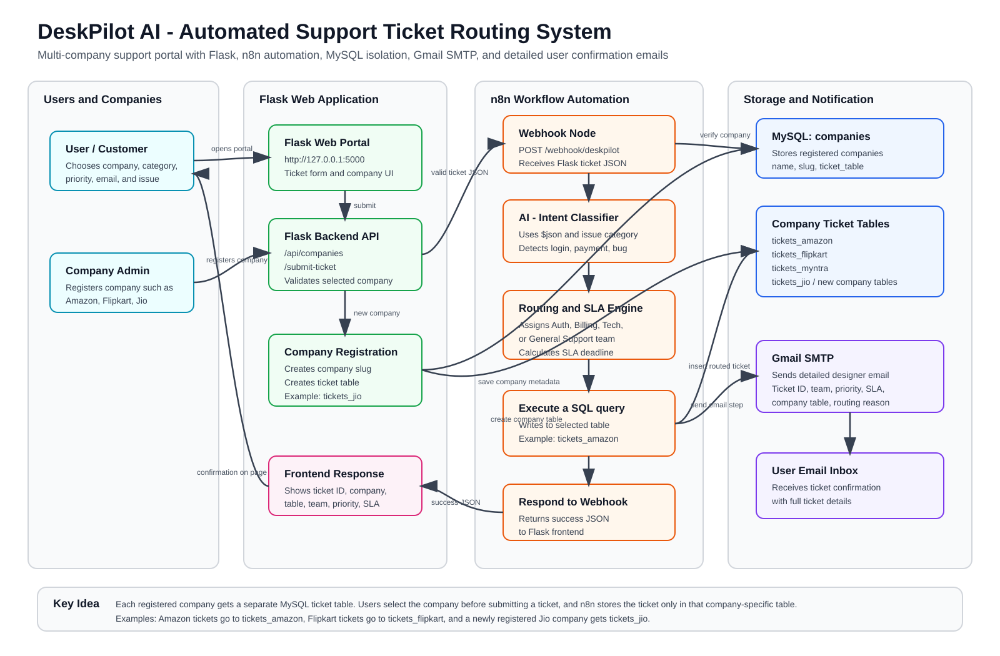
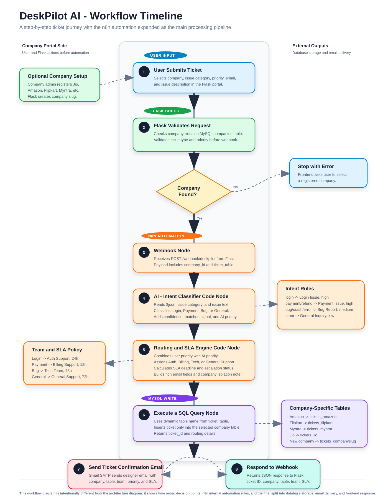

# DeskPilot AI

A Flask-based support ticket portal connected to an n8n automation workflow and a MySQL database.

Customers select a company, choose an issue category and priority, and submit an issue description. Flask validates the submission and forwards it to an n8n webhook. The workflow applies rule-based classification, resolves priority, assigns a support team and SLA, stores the ticket in the selected company's table, and prepares a confirmation email.

> **Implementation note:** The intent classifier is a rule-based keyword/category classifier implemented in an n8n Code node. It is not a trained machine-learning model or an external LLM integration.

## Features

- Customer ticket submission through a Flask web interface.
- Registration of additional companies through the application.
- Separate MySQL ticket tables for registered companies.
- Rule-based classification into login, payment, bug-report, and general-inquiry intents.
- Priority resolution using the submitted priority and classification rules.
- Team assignment and SLA calculation.
- Ticket persistence in MySQL.
- Customer confirmation email through an n8n SMTP node.
- Architecture and workflow diagrams.

## Architecture



## n8n workflow



The workflow contains these nodes:

1. Webhook Node
2. AI Intent Classifier (rule-based Code node)
3. Routing & SLA Engine
4. Execute a SQL query
5. Prepare Confirmation Email Data
6. Send Ticket Confirmation Email
7. Respond to Webhook

The workflow's SQL and SMTP nodes require credentials to be configured in n8n after importing the workflow JSON.

## Routing rules

| Classified intent | Assigned team | SLA |
| --- | --- | ---: |
| Login Issue | Auth Support | 24 hours |
| Payment Issue | Billing Support | 12 hours |
| Bug Report | Tech Team | 48 hours |
| General Inquiry | General Support | 72 hours |

The workflow calculates an `escalation` flag for high-priority tickets or tickets with an SLA of 24 hours or less. The current workflow does not implement a separate escalation notification or monitoring process.

## Technology stack

| Component | Technology |
| --- | --- |
| Frontend | HTML, CSS, JavaScript |
| Backend | Python, Flask |
| Workflow automation | n8n |
| Database | MySQL |
| Email delivery | SMTP through an n8n Email Send node |
| Application server for deployment | Gunicorn |
| Diagrams | SVG, draw.io |

## Repository structure

```text
DeskPilot-AI/
├── templates/
│   └── index.html
├── .env.example
├── .gitignore
├── app.py
├── architecture_diagram.svg
├── database.sql
├── DEPLOYMENT.md
├── deskpilot_architecture.svg
├── deskpilot_workflow.svg
├── deskpilot_workflow_diagram.drawio
├── deskpilot_workflow_diagram.svg
├── n8n_workflow.json
├── README.md
├── render.yaml
└── requirements.txt
```

## Requirements

Install or configure the following before running the application:

- Python 3
- MySQL Server and the MySQL command-line client
- Node.js and npm (for running n8n with `npx`)
- An n8n instance
- SMTP credentials configured in n8n if confirmation emails are required

## Run locally

### 1. Open the project directory

```powershell
cd "C:\path\to\DeskPilot-AI"
```

### 2. Install Python dependencies

```powershell
python -m pip install -r requirements.txt
```

### 3. Create the database and initial tables

Run this from Command Prompt, or invoke it from PowerShell through `cmd`:

```powershell
cmd /c "mysql -u root -p < database.sql"
```

The SQL script creates the `deskpilot_ai` database, the `companies` table, a generic `tickets` table, initial tables for Amazon, Flipkart and Myntra, and the initial company records.

### 4. Set Flask environment variables

Set these in the same PowerShell window in which Flask will run. Replace the example values with your own local configuration.

```powershell
$env:MYSQL_HOST = "localhost"
$env:MYSQL_PORT = "3306"
$env:MYSQL_USER = "root"
$env:MYSQL_PASSWORD = "your_mysql_password"
$env:MYSQL_DATABASE = "deskpilot_ai"
$env:N8N_WEBHOOK_URL = "http://localhost:5678/webhook/deskpilot"
```

Do not commit real credentials or put them in source files.

### 5. Start n8n

In a separate terminal:

```powershell
npx n8n
```

Open `http://localhost:5678`, import `n8n_workflow.json`, and configure the workflow's MySQL and SMTP credentials in n8n.

For local testing, use the webhook's test URL while the workflow is listening for a test event. For normal active workflow execution, activate the workflow and use its production webhook URL. Ensure the URL configured in `N8N_WEBHOOK_URL` matches the mode being used.

### 6. Start Flask

In the terminal where the environment variables were set:

```powershell
python app.py
```

Open `http://127.0.0.1:5000`.

The `app.py` development entry point enables Flask debug mode. Do not use `python app.py` as a production server; use the Gunicorn command shown in the deployment guide.

## Verify stored tickets

Tickets are stored in company-specific tables. For example:

```sql
USE deskpilot_ai;

SHOW TABLES;

SELECT * FROM companies;
SELECT * FROM tickets_amazon;
SELECT * FROM tickets_flipkart;
SELECT * FROM tickets_myntra;
```

Newly registered companies receive a table named from their generated company slug, with a `tickets_` prefix.

## Deployment

`render.yaml` defines a Render web service for the Flask application using:

```text
Build command: pip install -r requirements.txt
Start command: gunicorn app:app
```

It does not provision MySQL or host n8n. Those services must be available separately, and their connection details must be supplied as environment variables. See [DEPLOYMENT.md](DEPLOYMENT.md) for the deployment outline.

Hosting plans, free tiers, trials, and provider capabilities can change; check the provider's current documentation and pricing before deploying.

## Security and limitations

- The application expects database and webhook settings through environment variables.
- The n8n workflow uses separately configured MySQL and SMTP credentials.
- The current company-registration endpoint has no authentication or authorization layer.
- The current application does not show rate limiting or comprehensive production-grade input validation.
- Flask error responses currently include exception details in some failure paths.
- The escalation value is a stored flag; it does not trigger a separate escalation workflow.
- Do not expose this application publicly as a production service until access control, input validation, rate limiting, error handling, HTTPS, and database permissions have been reviewed.
- Use a dedicated database user with only the permissions the application and workflow require. Do not use a database administrator account in production.
- Never commit `.env` files, database passwords, SMTP passwords, API keys, or other secrets. Keep `.env.example` limited to placeholder values.
